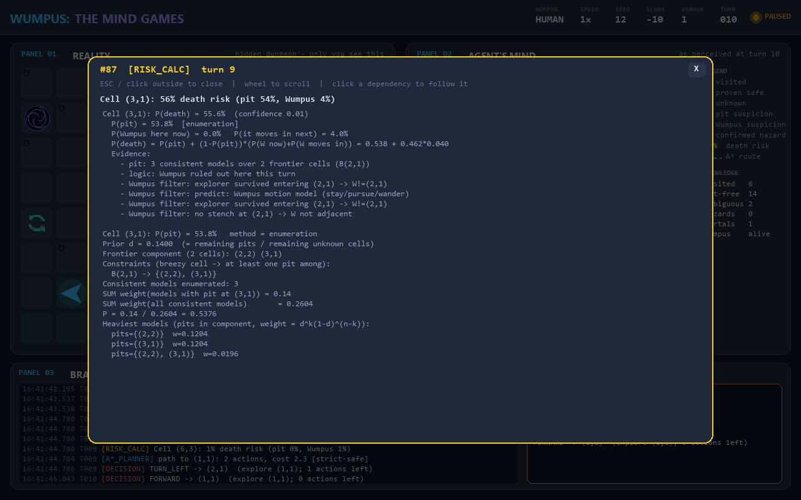

# WUMPUS: THE MIND GAMES

An adversarial AI game. **You play the Wumpus**, a monster that sees the whole dungeon. An **AI explorer**
that cannot see the map has to find the gold and escape, reasoning only from what it senses. Every
decision it makes is shown live in a *Brain View*, and each entry can be opened to see the exact
evidence and calculation behind it.


## Problem statement

The explorer works under **partial observability** against an **adversary**:

* it never sees pits, gold, portals, special tiles or the Wumpus; it only gets percepts
  (breeze, stench, glitter, bump, scream, portal signal, unstable floor, shuffle, teleported);
* the hazards are partly **dynamic**: the Wumpus moves (it is you), tiles collapse behind the explorer,
  shuffle tiles move pits, and portals relocate it;
* it must turn its percepts into certain facts, quantified risks and plans, and react to a
  hostile opponent, without ever reading the hidden map.

## AI techniques (all implemented from scratch, no AI libraries)

| Technique | Where | What it does |
|---|---|---|
| Propositional logic + DPLL | `wumpus/agents/knowledge_base.py` | Propositions `PIT_x_y`, `BREEZE_x_y`, `WUMPUS_x_y`, `STENCH_x_y`, `SAFE_x_y`, `PORTAL_x_y`, `SIGNAL_x_y`. CNF rules, entailment by refutation, proven safe / proven hazard / ambiguous, contradiction cores, time-stamped Wumpus facts that expire |
| Bayesian estimation | `wumpus/agents/bayesian.py`, `wumpus_tracker.py` | Exact pit posteriors by enumerating consistent frontier models; HMM forward filter over the moving Wumpus; per-cell P(pit), P(Wumpus), P(death), confidence |
| A* search | `wumpus/agents/pathfinding.py` | State (cell, facing, jump); turns, 3-cell jumps, learned portals, collapsed cells, risk costs; strict-safe and risk-tolerant modes; alternatives and rejection reasons |
| Minimax + alpha-beta | `wumpus/agents/minimax.py` | Belief-weighted determinized search (top-4 Wumpus hypotheses, 4 plies), predicted Wumpus replies, pruned-branch log; also drives the optional AI Wumpus |
| Dynamic replanning | `wumpus/agents/explorer.py` | Plans are kept until a trigger fires (collapse on the path, risk rose, unexpected position/teleport, refuted Minimax prediction, goal change), and the reason is logged |

Design reasoning, probability formulas, Minimax assumptions and simplifications are in
**[DECISIONS.md](DECISIONS.md)**. Every game rule and state transition is in **[RULES.md](RULES.md)**.

## Architecture

```
main.py                    GUI (default) or --terminal
wumpus/
  config.py                GameConfig (rules, seed) / AgentConfig (agent parameters, ablation flags)
  core/                    shared value types: Pos, actions, Percept, PublicInfo (no hidden data)
  environment/             HIDDEN ground truth: world.py, mechanics.py, percepts.py, events.py, engine.py
  agents/                  the explorer: knowledge_base, bayesian, wumpus_tracker, pathfinding, minimax,
                           explorer (pipeline), trace (Brain log)  - may only import core/
  control/                 Wumpus controllers: human, scripted (idle/random/hunter), minimax AI
  ui/                      Pygame interface: theme, icons, session (threaded AI), anim, board_view,
                           brain_panel, app
  terminal.py, runner.py   terminal version, headless game loop
  metrics.py, human_log.py evaluation metrics (beliefs vs hidden world), human-game recording
evaluation/                scenarios.py (10 fixed dungeons), benchmark.py, oracle.py (winnability),
                           human_games.py, results/
tests/                     17 smoke tests (one per component)
```

**Separation of hidden and known state.** The explorer receives a frozen `PublicInfo` once and a
frozen `Percept` per turn, and nothing else. A test in `tests/test_smoke.py` fails if anything in
`wumpus/agents/` imports `environment`, `ui`, `control` or `pygame`. In the GUI, the Agent's Mind
board is drawn from `agent.knowledge()` only, never from the world.

## Game mechanics (summary; full rules in RULES.md)

* 8×8 grid, explorer starts at (0,0) facing right; start and its neighbours are completely safe.
* 7 pits (13.5% of eligible cells), 2 hidden **portal pairs**, 3 **collapsing tiles** (become a pit
  when the explorer leaves), 2 **shuffle tiles** (seeded swap of a pit with an empty unvisited cell),
  one **jump** (lands 3 cells ahead, skipping what is between), one arrow.
* Explorer actions: FORWARD, TURN_LEFT, TURN_RIGHT, JUMP, GRAB, SHOOT, CLIMB. Wumpus: move one cell or stay.
* Score: −1 per action, −10 per arrow, +1000 escaping with gold, −1000 death. Turn limit 150.
* Every map is generated from a seed and checked for a walkable route to the gold and back.

## Installation

Python 3.11+.

```
python -m venv .venv
.venv\Scripts\python -m pip install -r requirements.txt        (Windows)
.venv/bin/python -m pip install -r requirements.txt            (macOS / Linux)
```

Dependencies: `pygame` (interface) and `pytest` (tests). No GPU, no network, no paid APIs.

## How to play

When the window opens you first see a three-page **How to play** screen (your goal as the Wumpus,
how to win, what the explorer can sense, how to read the panels, the controls). Press **H** or use the
menu to open it again at any time.


**You win** if the explorer falls into a pit, walks into you (or you step onto it), or has not escaped
after 150 turns. **It wins** by grabbing the gold and climbing out at the entrance (bottom-left).
If it climbs out without the gold, the game is a draw.

```
python main.py                       # window: you are the Wumpus (seed 7)
python main.py --seed 12             # another reproducible dungeon
python main.py --wumpus minimax      # watch AI vs AI (random / hunter / minimax / idle)
python main.py --terminal            # terminal version
```

| Key | Action |
|---|---|
| W A S D / arrow keys, X | move the Wumpus / stay (on your turn); or click a cyan-outlined cell |
| SPACE | single step (use with pause) |
| P | pause / resume |
| R / N | restart the same map / new map |
| + / − | animation and AI speed |
| ESC | menu (resume, restart, new map, Wumpus controller, speed, quit) |
| F | Brain log: key tags / all tags |
| mouse wheel, click | scroll the Brain log; click an entry to inspect its evidence |

Terminal version: `w a s d`, `x` stay, `i <id>` inspect an entry, `b` brain entries of the last turn,
`k` explorer's pit map, `m` its belief about where you are, `h` help, `q` quit.

## Demo scenarios

Maps that show each technique at work (all replayed and checked). A printable version with what to
point out is in [docs/DEMO_SCENARIOS.txt](docs/DEMO_SCENARIOS.txt).

| # | Command | What it shows |
|---|---|---|
| 1 | `python main.py` | You play the Wumpus. Pause with P and click a [RISK_CALC] or [INFERENCE] line to see the probability calculation or the logic proof. Stand next to the explorer to trigger [MINIMAX]. |
| 2 | `python main.py --seed 1086 --wumpus hunter` | Minimax: on turn 3 it shoots, the scream confirms the kill, and the explorer wins. Without Minimax the same agent is eaten on this map. |
| 3 | `python main.py --seed 1057 --wumpus idle` | Logic and Bayes alone: a 17-action win against a Wumpus that never moves. |
| 4 | `python main.py --seed 1007 --wumpus idle` | The walk-in check (DECISIONS D17): press F and look for "walk-in check" warnings around turns 25-50. The explorer survives (a draw). |
| 5 | `python main.py --wumpus minimax` | The hardest opponent: an all-seeing AI Wumpus that wins most games. |
| 6 | `python -m evaluation.scenarios` | The 10 fixed test dungeons; all print PASS. |

## How to read the Brain View

**PANEL 01 / REALITY** is the true dungeon (only you see it). Small hexagons show where a breeze **B**
or stench **S** would be felt; they are lit at the explorer's cell. Cyan outlines are your legal moves.

**PANEL 02 / AGENT'S MIND** shows only what the explorer knows, as perceived at the shown turn:

| Colour / mark | Meaning |
|---|---|
| dark emerald | visited |
| emerald | proven pit-free by logic |
| slate | unknown |
| crimson fill (intensity = probability) | pit suspicion from the Bayesian enumeration |
| amber outline (thickness = probability) | Wumpus suspicion from the filter |
| red X | confirmed hazard (proven pit, collapsed tile, Wumpus certain this turn) |
| yellow / orange % | P(death) of frontier cells (orange ≥ 30%) |
| cyan dashed line | current A* route |

**PANEL 03 / BRAIN ACTIVITY** is the explorer's real reasoning log, timestamped and colour-coded:
`[INFERENCE]` logical proofs, `[RISK_CALC]` probability estimates, `[A*_PLANNER]` routes,
`[MINIMAX]` adversarial search, `[DECISION]` the chosen action (plus EVENT, REPLAN, WARNING; press F
for everything). **Click any line** to open its stored evidence. A RISK_CALC shows the prior, the
breeze constraints, every consistent model and `P = Σ pit weight / Σ weight`. An INFERENCE shows the
DPLL refutation and the clauses it used, with their sources. A MINIMAX shows E[V] per action, the
predicted Wumpus replies and the pruned branches. Click a dependency to follow the chain.



**Why does the explorer walk back over cells it has already visited?** It only learns what is in a
cell by standing in it. It steps forward to probe a new cell. If it feels a breeze there, any
unexplored neighbour might be a pit, so it steps back to safe ground. Visited cells are the only cells
it *knows* are safe, so it walks back through them to reach the next unexplored area or the exit.
Measured over 40 games, about 1 in 3 moves lands on an already visited cell. Of the immediate
back-and-forth moves, 77% follow a breeze and most of the rest follow another warning (stench,
portal signal, unstable floor). Every such move is labelled in the log, e.g.
`FORWARD -> (2,1): backtracking over safe, already visited cells to reach (1,1) (breeze here, so a
neighbour may be a pit)`. The current goal is shown as **GOAL** on the Mind board and in the
decision box.

## Testing methodology

* **17 smoke tests** (`python -m pytest`, about 10 s), one per component: hidden-information
  separation (static import check), seeded world generation, turn order and illegal moves, action
  events, DPLL pit deduction, pit probabilities against the AIMA textbook numbers, A* against
  Dijkstra, alpha-beta on the AIMA textbook tree, a full AI game, one fixed scenario, the terminal
  version, the GUI (SDL dummy video driver), the winnability oracle, human-game recording and a
  regression test for the Minimax walk-in bug (D17).
* **10 deterministic scenarios** (`python -m evaluation.scenarios`): safe exploration,
  logical pit deduction, ambiguous hazards, moving
  Wumpus, teleporter discovery, collapsing route, shuffle event, jump opportunity, adversarial trap,
  gold retrieval and escape. Each checks concrete events and Brain entries. All 10 pass.
* **Benchmark** on 500 held-out maps (below). While developing the agent I only watched seeds 0-29.
* **Clean-environment check:** fresh clone + fresh venv + `pip install -r requirements.txt` →
  all tests pass, terminal game runs, GUI launches (headless).

## Benchmark results (actual, `python -m evaluation.benchmark`)

Automated **AI-versus-AI** games only; human games are recorded separately (below). 500 held-out maps
per cell (seeds 1000-1499), 150-turn limit, every agent on the same maps. Brackets are 95% confidence
intervals. All tables are in [evaluation/results/benchmark.md](evaluation/results/benchmark.md), per-game
data in `benchmark.json`.

**Every map is winnable.** An omniscient explorer (`evaluation/oracle.py`: A* over the real mechanics,
idle Wumpus) wins all 500 maps, in a median 17 actions. So every loss below is the agent's, not the map's.

| Agent | vs idle Wumpus | vs random Wumpus | vs hunter Wumpus | vs Minimax Wumpus |
|---|---|---|---|---|
| random baseline | 1% | 1% | 0% | 0% |
| logic + A* | 25% [21, 29] | 20% [16, 23] | 4% [3, 7] | 4% [2, 6] |
| logic + Bayes + A* | **54%** [49, 58] | 31% [27, 35] | 5% [3, 7] | **5%** [4, 8] |
| full hybrid (+ Minimax) | 53% [48, 57] | **36%** [32, 41] | **18%** [15, 21] | 4% [3, 7] |

Win rates. Average planning time is 10-37 ms per decision (max 0.4 s; 1.7 s at search depth 6).

What the numbers say (each comparison is paired on the same 500 maps, exact McNemar test):

* **Bayesian estimation is the biggest single gain:** 25% → 54% against an idle Wumpus and 20% → 31%
  against a random one (both p < 0.001). Logic alone never falls into a pit, but it retreats
  empty-handed in 39-47% of games because it cannot prove enough cells safe.
* **Minimax helps against a Wumpus that comes for you:** 5% → 18% against the hunter (p < 0.001)
  and 31% → 36% against a random Wumpus (p = 0.003). Against an idle Wumpus it makes no significant
  difference (54% vs 53%, p = 0.61), as expected: there is no duel to win.
* **Nothing beats the omniscient Minimax Wumpus** (4-5% for every reasoning agent; Minimax's 22 vs 26
  wins is not a significant difference, p = 0.13). That opponent waits diagonally, where it causes no
  stench, and strikes when the explorer steps adjacent. It also searches the explorer's replies, so it
  never stays in the line of fire: all 265 arrows fired at it missed.
* **Minimax works where it acts.** On *danger turns* (decisions made with the real Wumpus adjacent)
  the explorer is eaten in that turn 42% of the time with Minimax vs 59% without against the hunter,
  38% vs 49% against the Minimax Wumpus and 15% vs 19% against a random one. Against an idle Wumpus it
  is still slightly worse (5% vs 2%). It was 7%, because Minimax stepped into the Wumpus' most likely
  cell; that bug is fixed (DECISIONS D17). The rest of the gap comes from the fixed motion model: at
  first contact the explorer cannot tell an idle Wumpus from one that attacks.
* **Minimax settings barely matter** (200 maps): depth 2, 4 or 6 and 1, 4 or 8 Wumpus hypotheses all
  win 18-21% against the hunter and 4-5% against the Minimax Wumpus. Depth 6 is worse on danger turns
  (50% eaten vs 38%) and its slowest decision takes 1.7 s. Depth 2 is as good as the default (depth 4).
* **Pit probabilities are well calibrated.** Frontier cells given 20-30% held a pit 26% of the time,
  50-60% → 53%, 90-100% → 99.7%. Brier score 0.089, against 0.200 for a baseline that only knows the
  pit density.
* **The Wumpus tracker is the weakest component.** It puts 3-9% on the Wumpus' true cell (a uniform
  guess gives 1.6%) and its top guess is right 3-12% of the time. Stench is only sensed next to the
  Wumpus, so most turns carry little information about where it is.
* **Wins take about 3x the oracle's actions** (median 2.9-3.3x against idle and random Wumpus): the
  price of exploring without a map.
* The held-out win rate (36% vs a random Wumpus) is **lower than on the seeds used during
  development** (15 of 30 = 50% in the last development sweep). Part of the tuning fit those maps.

### Human games

Every finished game in which you play the Wumpus (GUI or terminal) is appended to
`evaluation/results/human_games.jsonl`, with the same metrics as the benchmark. `python -m
evaluation.human_games` summarises them. No human games have been recorded yet.

## Limitations

* **Minimax under partial observability** uses determinization (top-4 hypotheses treated as known),
  so strategy fusion is possible. It assumes a worst-case opponent and a 4-ply horizon, and pit risk
  is charged instead of branched on (no expectiminimax).
* **The rules favour an omniscient, aggressive Wumpus.** It moves every turn and stench is only
  sensed adjacently, so against the Minimax Wumpus the explorer wins 4-5% of games.
* **The Wumpus motion model** (15% stay, 50% pursuit, 50% wander) is a fixed assumption about the
  human. When the human does something it gives zero probability, the filter resets to uniform (logged).
* **Pit prior** uses an independent δ per cell rather than the exact pit count, and frontier
  components above 18 cells use a labelled approximation (not observed in practice on 8×8).
* **Explorer behaviour** is rule-based on top of the algorithms (tiers, risk caps, anti-paralysis,
  stuck/retreat). Those thresholds were tuned on development seeds.
* **Turn limit** of 150 is reached in up to 11% of games (Bayes agents against an idle Wumpus).