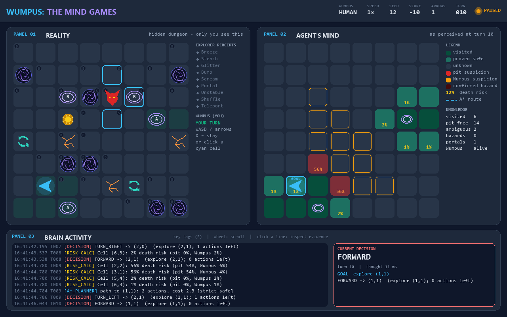
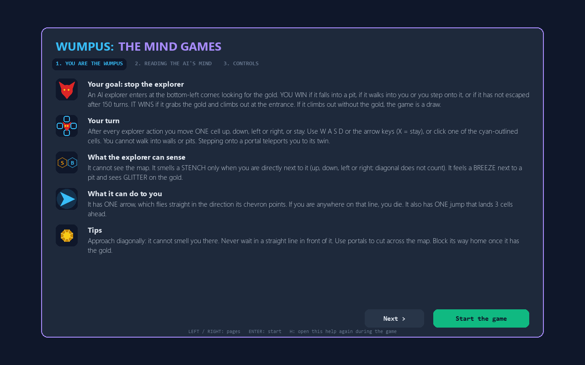

# WUMPUS: THE MIND GAMES

An adversarial AI game. **You play the Wumpus**, a monster that sees the whole dungeon. An **AI explorer**
that cannot see the map has to find the gold and escape, reasoning only from what it senses. Every
decision it makes is shown live in a *Brain View*, and each entry can be opened to see the exact
evidence and calculation behind it.



## Problem statement

The explorer works under **partial observability** against an **adversary**:

* it never sees pits, gold, portals, special tiles or the Wumpus; it only gets percepts
  (breeze, stench, glitter, bump, scream, portal signal, unstable floor, shuffle, teleported);
* the hazards are partly **dynamic**: the Wumpus moves (it is you), tiles collapse behind the explorer,
  shuffle tiles move pits, and portals relocate it;
* it must turn its percepts into certain facts, quantified risks and plans, and react to a
  hostile opponent, without ever reading the hidden map.

## AI techniques (all implemented from scratch, no AI libraries)

| Technique | Where | What it does |
|---|---|---|
| Propositional logic + DPLL | `wumpus/agents/knowledge_base.py` | Propositions `PIT_x_y`, `BREEZE_x_y`, `WUMPUS_x_y`, `STENCH_x_y`, `SAFE_x_y`, `PORTAL_x_y`, `SIGNAL_x_y`. CNF rules, entailment by refutation, proven safe / proven hazard / ambiguous, contradiction cores, time-stamped Wumpus facts that expire |
| Bayesian estimation | `wumpus/agents/bayesian.py`, `wumpus_tracker.py` | Exact pit posteriors by enumerating consistent frontier models; HMM forward filter over the moving Wumpus; per-cell P(pit), P(Wumpus), P(death), confidence |
| A* search | `wumpus/agents/pathfinding.py` | State (cell, facing, jump); turns, 3-cell jumps, learned portals, collapsed cells, risk costs; strict-safe and risk-tolerant modes; alternatives and rejection reasons |
| Minimax + alpha-beta | `wumpus/agents/minimax.py` | Belief-weighted determinized search (top-4 Wumpus hypotheses, 4 plies), predicted Wumpus replies, pruned-branch log; also drives the optional AI Wumpus |
| Dynamic replanning | `wumpus/agents/explorer.py` | Plans are kept until a trigger fires (collapse on the path, risk rose, unexpected position/teleport, refuted Minimax prediction, goal change), and the reason is logged |

Design reasoning, probability formulas, Minimax assumptions and simplifications are in
**[DECISIONS.md](DECISIONS.md)**. Every game rule and state transition is in **[RULES.md](RULES.md)**.

## Architecture

```
main.py                    GUI (default) or --terminal
wumpus/
  config.py                GameConfig (rules, seed) / AgentConfig (agent parameters, ablation flags)
  core/                    shared value types: Pos, actions, Percept, PublicInfo (no hidden data)
  environment/             HIDDEN ground truth: world.py, mechanics.py, percepts.py, events.py, engine.py
  agents/                  the explorer: knowledge_base, bayesian, wumpus_tracker, pathfinding, minimax,
                           explorer (pipeline), trace (Brain log)  - may only import core/
  control/                 Wumpus controllers: human, scripted (idle/random/hunter), minimax AI
  ui/                      Pygame interface: theme, icons, session (threaded AI), anim, board_view,
                           brain_panel, app
  terminal.py, runner.py   terminal version, headless game loop
evaluation/                scenarios.py (10 fixed dungeons), benchmark.py, results/
tests/                     304 pytest tests (unit, integration, separation, UI)
```

**Separation of hidden and known state.** The explorer receives a frozen `PublicInfo` once and a
frozen `Percept` per turn, and nothing else. `tests/test_separation.py` fails if anything in
`wumpus/agents/` imports `environment`, `ui`, `control` or `pygame`, and it replays a recorded percept
stream into a fresh agent to show its actions depend on percepts only. In the GUI, the Agent's Mind
board is drawn from `agent.knowledge()` only, never from the world.

## Game mechanics (summary; full rules in RULES.md)

* 8×8 grid, explorer starts at (0,0) facing right; start and its neighbours are completely safe.
* 7 pits (13.5% of eligible cells), 2 hidden **portal pairs**, 3 **collapsing tiles** (become a pit
  when the explorer leaves), 2 **shuffle tiles** (seeded swap of a pit with an empty unvisited cell),
  one **jump** (lands 3 cells ahead, skipping what is between), one arrow.
* Explorer actions: FORWARD, TURN_LEFT, TURN_RIGHT, JUMP, GRAB, SHOOT, CLIMB. Wumpus: move one cell or stay.
* Score: −1 per action, −10 per arrow, +1000 escaping with gold, −1000 death. Turn limit 150.
* Every map is generated from a seed and checked for a walkable route to the gold and back.

## Installation

Python 3.11+.

```
python -m venv .venv
.venv\Scripts\python -m pip install -r requirements.txt        (Windows)
.venv/bin/python -m pip install -r requirements.txt            (macOS / Linux)
```

Dependencies: `pygame` (interface) and `pytest` (tests). No GPU, no network, no paid APIs.

## How to play

When the window opens you first see a three-page **How to play** screen (your goal as the Wumpus,
how to win, what the explorer can sense, how to read the panels, the controls). Press **H** or use the
menu to open it again at any time.



**You win** if the explorer falls into a pit, walks into you (or you step onto it), or has not escaped
after 150 turns. **It wins** by grabbing the gold and climbing out at the entrance (bottom-left).
If it climbs out without the gold, the game is a draw.

```
python main.py                       # window: you are the Wumpus (seed 7)
python main.py --seed 12             # another reproducible dungeon
python main.py --wumpus minimax      # watch AI vs AI (random / hunter / minimax / idle)
python main.py --terminal            # terminal version
```

| Key | Action |
|---|---|
| W A S D / arrow keys, X | move the Wumpus / stay (on your turn); or click a cyan-outlined cell |
| SPACE | single step (use with pause) |
| P | pause / resume |
| R / N | restart the same map / new map |
| + / − | animation and AI speed |
| ESC | menu (resume, restart, new map, Wumpus controller, speed, quit) |
| F | Brain log: key tags / all tags |
| mouse wheel, click | scroll the Brain log; click an entry to inspect its evidence |

Terminal version: `w a s d`, `x` stay, `i <id>` inspect an entry, `b` brain entries of the last turn,
`k` explorer's pit map, `m` its belief about where you are, `h` help, `q` quit.

## How to read the Brain View

**PANEL 01 / REALITY** is the true dungeon (only you see it). Small hexagons show where a breeze **B**
or stench **S** would be felt; they are lit at the explorer's cell. Cyan outlines are your legal moves.

**PANEL 02 / AGENT'S MIND** shows only what the explorer knows, as perceived at the shown turn:

| Colour / mark | Meaning |
|---|---|
| dark emerald | visited |
| emerald | proven pit-free by logic |
| slate | unknown |
| crimson fill (intensity = probability) | pit suspicion from the Bayesian enumeration |
| amber outline (thickness = probability) | Wumpus suspicion from the filter |
| red X | confirmed hazard (proven pit, collapsed tile, Wumpus certain this turn) |
| yellow / orange % | P(death) of frontier cells (orange ≥ 30%) |
| cyan dashed line | current A* route |

**PANEL 03 / BRAIN ACTIVITY** is the explorer's real reasoning log, timestamped and colour-coded:
`[INFERENCE]` logical proofs, `[RISK_CALC]` probability estimates, `[A*_PLANNER]` routes,
`[MINIMAX]` adversarial search, `[DECISION]` the chosen action (plus EVENT, REPLAN, WARNING; press F
for everything). **Click any line** to open its stored evidence. A RISK_CALC shows the prior, the
breeze constraints, every consistent model and `P = Σ pit weight / Σ weight`. An INFERENCE shows the
DPLL refutation and the clauses it used, with their sources. A MINIMAX shows E[V] per action, the
predicted Wumpus replies and the pruned branches. Click a dependency to follow the chain.


**Why does the explorer walk back over cells it has already visited?** It only learns what is in a
cell by standing in it. It steps forward to probe a new cell. If it feels a breeze there, any
unexplored neighbour might be a pit, so it steps back to safe ground. Visited cells are the only cells
it *knows* are safe, so it walks back through them to reach the next unexplored area or the exit.
Measured over 40 games, about 1 in 3 moves lands on an already visited cell. Of the immediate
back-and-forth moves, 77% follow a breeze and most of the rest follow another warning (stench,
portal signal, unstable floor). Every such move is labelled in the log, e.g.
`FORWARD -> (2,1): backtracking over safe, already visited cells to reach (1,1) (breeze here, so a
neighbour may be a pit)`. The current goal is shown as **GOAL** on the Mind board and in the
decision box.

## Testing methodology

* **304 pytest tests** (`python -m pytest`): one per rule in RULES.md; DPLL against truth tables;
  pit probabilities against the AIMA textbook numbers and full-joint brute force; A* against
  Dijkstra (optimal cost, admissible heuristic); alpha-beta against plain minimax; replanning
  triggers; contradiction cores; read-only knowledge snapshot; terminal driven by scripted keystrokes;
  GUI driven by injected key and mouse events with SDL's dummy video driver (including a check that
  frames keep flowing while the AI thinks).
* **10 deterministic scenarios** (`python -m evaluation.scenarios`, also run by
  `tests/test_integration.py`): safe exploration, logical pit deduction, ambiguous hazards, moving
  Wumpus, teleporter discovery, collapsing route, shuffle event, jump opportunity, adversarial trap,
  gold retrieval and escape. Each checks concrete events and Brain entries. All 10 pass.
* **Separation tests** (static imports + percept replay) for hidden-information leaks.
* **Benchmark** on 100 held-out maps (below). While developing the agent I only watched seeds 0-29.
* **Clean-environment check:** fresh clone + fresh venv + `pip install -r requirements.txt` →
  300/300 tests pass, terminal game runs, GUI launches (headless).

## Benchmark results (actual, `python -m evaluation.benchmark`)

Automated **AI-versus-AI** games only; human games are never part of these statistics. 100 maps per
cell (seeds 1000-1099), 150-turn limit. Full tables and per-game JSON in `evaluation/results/`.

| Agent | vs random Wumpus: win / survival / avg score | vs hunter Wumpus: win / survival | vs Minimax Wumpus: win / survival |
|---|---|---|---|
| random baseline | 1% / 1% / −1005 | 0% / 0% | 0% / 0% |
| logic + A* | 25% / 66% / **−120** | 6% / **21%** | 3% / **23%** |
| logic + Bayes + A* | 33% / 42% / −293 | 6% / 8% | 6% / 11% |
| full hybrid (+ Minimax) | **38%** / 51% / −162 | **13%** / 19% | **6%** / 10% |

Detail vs the random Wumpus: pit deaths 76 / 0 / 16 / 23, Wumpus deaths 23 / 34 / 42 / 26,
timeouts 0% / 1% / 2% / 5%, average planning time 0.1 / 15.5 / 27.6 / 36.2 ms per decision
(max 524 ms).

What the numbers say:

* Reasoning matters: the random baseline almost never wins; every reasoning agent does far better.
* **Logic only is the most cautious.** It never enters an unproven cell (zero pit deaths) and
  retreats for a draw in 40% of games, which gives the best *average score*, but the fewest wins.
* **Bayesian estimation buys wins with risk:** it explores beyond what logic can prove (+8 points of
  win rate) and pays with some pit deaths.
* **Minimax reduces deaths by the Wumpus** against a random Wumpus (42 → 26) and doubles the win rate
  against the greedy hunter (6% → 13%). Against the omniscient Minimax Wumpus it does not help (6%):
  that opponent waits diagonally, where it causes no stench, and strikes when the explorer steps
  adjacent. The explorer's senses cannot detect this in time.
* The held-out win rate (38% vs a random Wumpus) is **lower than on the seeds used during
  development** (15 of 30 = 50% in the last development sweep). Part of the tuning fit those maps.

## Limitations

* **Minimax under partial observability** uses determinization (top-4 hypotheses treated as known),
  so strategy fusion is possible. It assumes a worst-case opponent and a 4-ply horizon, and pit risk
  is charged instead of branched on (no expectiminimax).
* **The rules favour an omniscient, aggressive Wumpus.** It moves every turn and stench is only
  sensed adjacently, so against the Minimax Wumpus the explorer wins 6% of games.
* **The Wumpus motion model** (15% stay, 50% pursuit, 50% wander) is a fixed assumption about the
  human. When the human does something it gives zero probability, the filter resets to uniform (logged).
* **Pit prior** uses an independent δ per cell rather than the exact pit count, and frontier
  components above 18 cells use a labelled approximation (not observed in practice on 8×8).
* **Explorer behaviour** is rule-based on top of the algorithms (tiers, risk caps, anti-paralysis,
  stuck/retreat). Those thresholds were tuned on development seeds.
* **Turn limit** of 150 is reached in up to 5% of games.

## Incomplete features / honest notes

* The GUI was verified with automated key/mouse event injection and headless screenshots
  (see `docs/screenshots/`). Its controls and rendering were not
  play-tested by a human in an interactive window during development. Please report anything that
  feels wrong in real use.
* Animations are functional (movement tweens, jump arcs, rings and flashes for teleport, collapse,
  shuffle, gold, hits, new inferences and route changes) rather than elaborate. There is no sound.
* Human-versus-AI play is supported in both the GUI and the terminal, but no human games were
  recorded or analysed.
* The Agent's Mind panel draws the explorer where it *expects* to be after its latest action (its own
  prediction). A bump or an undiscovered portal can make that differ from Reality until its next percept.

## Future improvements

* Belief-state (POMDP-style) search instead of determinized Minimax; expectiminimax for pits.
* Learn the human's motion model online from the observed evidence instead of a fixed mixture.
* Exact pit-count prior (enumeration conditioned on the known number of pits).
* Deeper search with iterative deepening under a time budget, now that the AI runs in a worker thread.
* Record and replay human games (the engine is deterministic, so a move log is enough).
